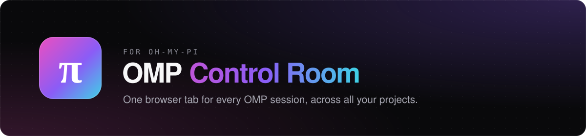
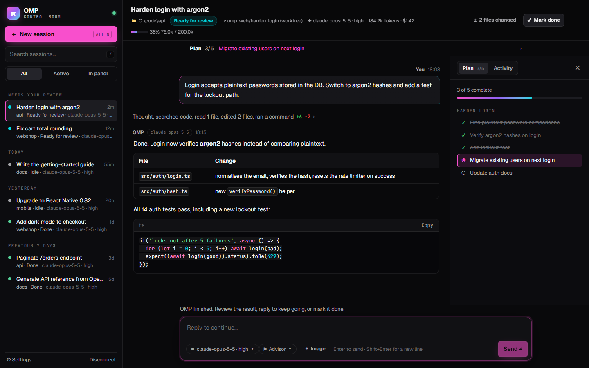
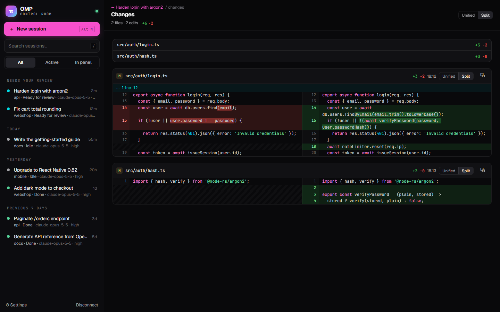
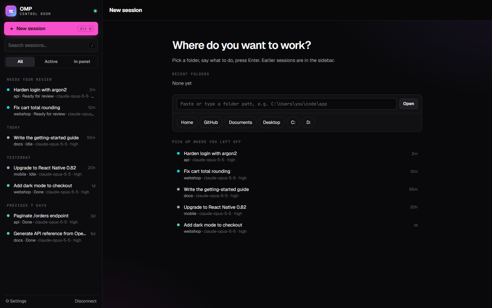

<p align="center"></p>

<p align="center">
  
  
  
</p>

**One browser tab for all your [oh-my-pi](https://github.com/can1357/oh-my-pi) sessions.** Run, watch and review OMP agents across many projects without juggling terminals.

<!-- Animated preview (plays inline, no sound). For a real player with sound, upload the MP4 through GitHub's web editor and put the resulting https://github.com/user-attachments/assets/... URL on its own line here. -->
<p align="center"></p>



<table>
  <tr>
    <td width="50%"></td>
    <td width="50%"></td>
  </tr>
  <tr>
    <td align="center"><sub>Review every change as a unified or split diff</sub></td>
    <td align="center"><sub>Start a session in any folder in two keystrokes</sub></td>
  </tr>
</table>

## Features

- **Every session in one sidebar**, including ones you started in a terminal, grouped by *Working now*, *Needs your review*, *Today* and older, or by project (▤); click a group's heading to collapse it. Search it (`/`), filter by *All*, *Active*, *In panel* or *Archived*, archive and restore sessions, and open one in a new tab (middle-click or right-click).
  - **Pin** sessions (pin button on a row) to keep them in a *Pinned* group above *Working now*, or first within their project when grouped by project. Pins persist across restarts; archiving a pinned session unpins it.
- **New session screen** (**Alt+N**): pick a recent folder, paste a path or browse subfolders with a filter, then type the first prompt. *Pick up where you left off* lists your latest sessions. Sessions from OMP history can be added to the panel without sending a message.
- **Continuous work timers:** the sidebar shows **Running** elapsed time, then the frozen **Last run** duration, using hours, minutes and seconds for long runs (e.g. `1h 5m 19s`). Steering, queued continuations, question prompts, retries and background waits stay in the same interval; hover for exact start/end times.
- **Readable conversations:** Markdown, tables and code blocks with copy. Tool calls and thinking fold into one activity summary.
- **GitHub-style diffs** with word-level highlights, in unified or split view; **± N files changed** in the top bar reviews every file a session touched.
  - **Edits / Working tree / Commits:** *Edits* lists what the agent changed with its edit and write tools; *Working tree* shows the real `git diff` of the session's folder against the commit it started from (or `HEAD`), including untracked files, so shell commands, formatters and your own edits show up too; *Commits* shows the folder's git state (branch, upstream with ahead/behind, uncommitted count) and its latest 50 commits (hash, subject, author, date; *this session* marks ones made since the session started). Click a commit to see its diff (merges against their first parent). The folder is the session's worktree when it is isolated. Also opens from *⋯ › Branch & recent commits*, even before the session has edited anything; the choice of tab is remembered.
  - **Viewed** (checkbox per file) folds a file you've reviewed until its diff changes again. Kept in this browser.
  - **Review comments:** click a line number to comment on it, then **Request changes** sends every comment to the session as one message, one `path:line: note` per line (removed lines say so). It goes as a steer while OMP is working, as a new prompt otherwise.
- **Open in editor:** file names in diffs, tool calls and the same-file warning open the file at the changed line, on the computer running the companion. *Settings › Notifications & editor* picks VS Code, VS Code Insiders, Cursor, Windsurf or *Show in folder*; *Automatic* uses the first editor it finds installed.
- **Live plan and activity panel** for todos, subagents with expandable live reasoning, background jobs and advisor transcripts; **Watch →** (subagents) and **Open transcript →** (advisors) open the full transcript. A running subagent has **Steer** (send it a message at its next step) and **Stop**; the parent session keeps running.
- **Notifications:** when a session finishes, fails or asks a question while you're looking elsewhere, the tab title counts it (`(2) OMP Control Room`) until you open it, and the browser shows a notification once you allow them (the first time, a toast offers it; also *Settings › Notifications & editor*). The desktop app shows native Windows notifications instead while its window isn't focused, and its taskbar title carries the count.
- **Side questions:** `/btw <question>` (or *⋯ › Ask a side question*) asks about the session without interrupting it or adding to its conversation. The answer streams into its own panel above the composer; ask follow-ups on the same topic, cancel, or reopen earlier ones from *History*. Uses OMP's own `/btw`.
- **Drafts follow you:** the unsent text in each session's composer is saved to the companion, so it survives reloads and shows up on your phone or another browser. Text you've changed on this device and not yet synced is kept and saved over the other device's version, never replaced by it.
- **Same-file warning:** when two active sessions in the same folder (no worktree) edit the same file, both show a banner naming the other session and the files, and the sidebar marks them *⚠ overlap*.
- **Native plan mode:** enable read-only planning before your first prompt (**Alt+Shift+P**), review the proposed Markdown plan, request refinement, or approve implementation with the current, fresh or compacted context. Requires an OMP build with plan-mode RPC support.
- **Native goal mode:** `/goal` opens an objective prompt or the current goal's controls; start autonomous work, replace an objective, pause/resume, set a token budget, or confirm dropping it. Requires an OMP build with goal-mode RPC support.
- **Smart composer:** send, steer a running turn (edit or cancel a steer until OMP reads it), queue follow-ups, attach images (button, paste or drag and drop), switch model or reasoning level from a searchable picker with favourites (Ctrl+P cycles configured default/smol/slow roles), toggle fast mode (⚡ chip, shown only for models with a priority service tier: Anthropic, OpenAI/Codex, Google, and their OpenRouter variants) in new and live sessions, use the ⚑ advisor menu to turn the advisor on or off (also before continuing a session from OMP history, applied before the first message), change its model, open its transcript, and filter its output in the chat (hide all while it keeps running, show reviews, important notes only), complete `/commands` in both new and live sessions (find skills by name, e.g. `/front` completes to `/skill:frontend-design`), complete the current word with Tab from OMP's local word predictor (n-gram or the tiny SmolLM2 model), rewrite the draft with **✨ Enhance** (below), and run `!command` in the session's shell.
- **Enhance prompt:** **✨** (or **Ctrl+Shift+E**) in every composer (live sessions, New session, and continuing a session from OMP history) rewrites your draft into a concrete prompt. Each click is one read-only `omp -p` run limited to read/grep/glob; it uses the repo's `AGENTS.md`/`CLAUDE.md`, the conversation tail and attached images to name real files and symbols. The draft is replaced in place, with **Undo** in the toast or Ctrl+Z; nothing is sent automatically, and **✕** cancels a run. The model is OMP's `enhance` role if set, otherwise the composer's model at the reasoning level set under *Settings › Enhance* (default low). On New session it creates a draft session, discarded if you leave without sending.
- **Provider usage:** **◔ Usage** in the top bar opens a live panel with every logged-in provider, the selected model's provider first, each under its own heading with one row per limit for every reported account: label, reset time, used percentage and a bar that turns red at 90 %. It refreshes in the background every 2 minutes while open; `/usage` posts the same providers to the chat as a text snapshot and works during a running turn without steering it or queueing another prompt.
- **Choose provider accounts:** logged in to the same provider more than once (for example two Claude subscriptions)? **⋯ › Choose provider accounts…** lists each provider's OAuth accounts; pick the one to use. Every session switches to it with OMP's own `/session pin` before its next message, so the choice covers new and running sessions, survives restarts (it's saved in `workspace.json`), and OMP no longer rotates that session to another account. Without a choice, OMP picks between the accounts itself. *Enhance prompt* runs (`omp -p`) have no session to pin and still use OMP's automatic pick. Reading the accounts from OMP takes a few seconds, so the companion reads them at startup and after each login from the panel, and refreshes them in the background each time the dialog opens: an account added with `omp login` in a terminal shows up the next time you open it.
- **Answer OMP's questions** (`ask` tool and extension prompts) directly in the browser. With OMP 18.10 or newer, an `ask` call arrives as one form: checkboxes for multi-select questions, radio buttons for single choice, an *Other* text field per question, and one **Submit**, so ticked options stay visible until you send them. Older OMP builds keep the one-click-per-option flow. Sessions with unanswered questions move to *Needs your review* until the last question is answered or cancelled, then return to their current work state. Extension notifications, status lines, widgets and sign-in links appear in the chat.
- **Auto-approve:** the **✓ Auto-approve** chip next to a session's model turns it on or off while the session runs, without restarting OMP. To have it on from the first turn, tick **Auto-approve** on the New session form (next to *Advisor*) before starting. While it's on, the companion answers OMP's tool-approval prompts (*Allow tool: …* → **Approve**, including MCP tools and eval preludes) and the computer tool's *Allow foreground computer control?* (→ **Yes**) as soon as they arrive, and each one it answers appears in the chat as *Auto-approved: …* with the full prompt. Turning it on also approves the approval prompts already waiting. `ask` questions, text and editor prompts, other choices and prompts that list provider safety checks still wait for you. It also continues a session that stopped on a provider **429 rate limit**: once OMP has given up retrying (for example because the provider's `retry-after-ms` wait is longer than OMP's `retry.maxDelayMs`), the chat shows *Rate limit reached; resuming automatically at HH:MM.*, and when the wait is over the companion resends the last message as **Retry** would. Stop, turning Auto-approve off or marking the session done cancels the wait (the chat says so); sending a message of your own replaces it. The resume time is saved, so a companion restart keeps the wait, and a time that passed while the companion was off resumes right after it starts. A last message with an image is not resent: reattach the image and send it yourself. With Auto-approve off, a 429 leaves the session in error until you press **Retry**. The setting is saved per session in `workspace.json`. Unlike the launch-time approval mode in **⚙ Options**, it doesn't change which tools OMP asks about, only who answers.
- **Session tools:** rename, browse the full **session tree**, copy the last reply, cycle OMP's model and thinking level, export as HTML, share a link, session stats, commit the folder's changes, provider login, **open a terminal in the session's folder** (`cmd` on Windows, Terminal on macOS, `x-terminal-emulator` on Linux; it opens on the computer running the companion, also when you use the panel from a phone), copy the working directory or `omp --resume` command, and **✓ Mark done**. While idle, the chat messages themselves carry the history actions: **Edit & resend** on your last message goes back to just before it and puts its text and images in the composer so you can change and resend it; **Regenerate** on the reply to it goes back the same way and sends that prompt again unchanged; **Branch from here** on any earlier message of yours continues from just before it, with that message back in the composer. The session menu keeps **Edit last message**, **Regenerate last reply** and **Branch from an earlier message** for the cases the chat can't show: a last message OMP didn't record as a prompt (a steer, or a command such as `/usage`), a turn that failed before replying, or messages older than the chat keeps. The session tree also has **Branch** on any of your messages, including ones on abandoned paths. The buttons need OMP's ID for each message: messages typed in the panel get it a few seconds after OMP finishes the turn, once it has stored them. Messages recorded without one (sent before this companion version, for example) get it the first time the session is idle after a companion start: the chat is then rebuilt from OMP's own record of the conversation (its active path), keeping the companion's own notes. The menu also hands off to a fresh context, compacts with optional instructions, starts a fresh OMP session (`/new`), switches the entry to another saved session, or removes it from the panel. OMP's RPC can only go back in time with its `branch` command, so edit, regenerate and branch all continue in a **new OMP session file** holding the conversation up to that point; the old file stays in OMP history unchanged with the replies you went back from. OMP's in-place `/tree` move exists only in its terminal UI. Per-session toggles cover fast mode, auto-compaction, auto-retry and steer/follow-up delivery (*Deliver all steers at once*, *Send all queued follow-ups together*, *Hold steers until the turn ends*).
- **Restart companion:** *⋯ › Restart companion…* in a session's top bar stops the companion and starts it again on the same port; the PC keeps running. After you confirm, running sessions are paused and saved as on quit, and the panel reconnects by itself (same connection token, no new browser tab); continue a session by sending it a message. A restart skips the `omp update` check. The item appears only when the companion runs from `start.bat`, which does the restarting; the desktop app and a plain `node companion/server.mjs` don't offer it.
- **Shut down PC:** *⋯ › Shut down PC…* in a session's top bar turns off the computer running the companion, also when you use the panel from a phone (`shutdown /s /t 0` on Windows, System Events on macOS, `systemctl poweroff` on Linux). After you confirm, running sessions are paused and saved as on quit, so you can continue them once the PC is back on. If the OS refuses (for example a Linux polkit rule), the panel shows its error and keeps working; the sessions stay paused. *⋯ › Shut down PC when all work is done* does the same once the work is finished: the companion waits until no session is running or queued and no compaction, handoff or shell command is in progress, then shuts down exactly as above (if nothing is working when you turn it on, it shuts down right away). Messages queued behind a running turn count as part of it; messages left queued in a stopped session only go out with your next message there, so they don't hold the shutdown and stay queued for later. While it waits, the sidebar and the view's top bar show it with a **Cancel** button and the number of sessions working; those sessions are the ones the sidebar's **Active** filter lists as working (a session compacting or running a shell command shows that instead of its status). Clicking the menu item again also cancels it. The option lives in the companion, so it holds when you close the panel, but not across a companion restart. If the OS refuses, the panel shows the error, the option turns itself off and the panel keeps working.
- **Stop & send:** while OMP is working, **■ Stop & send** cancels the current turn and sends your message in its place. Plain Enter still steers; Ctrl+Enter, Alt+Enter or Ctrl+Q queue it for after the turn.
- **Hotkeys:** *Settings › Hotkeys* sets the composer keys for **Queue** and **Stop & send** (comma-separated, e.g. `Ctrl+Enter, Alt+Q`; empty turns one off). A combo is Ctrl, Alt or Meta (plus optional Shift) and a letter, digit or key name such as Enter, Space, Tab, Up, Down or Esc. Letters follow your keyboard layout; when a combo types something else (Option+letter on a Mac, non-Latin layouts) the key's position counts instead. The dashboard's own shortcuts (Ctrl+P, Ctrl+Shift+E, Alt+Shift+P, Alt+↑/↓, Alt+N) can't be reused. They're saved in this browser. Some browsers keep Ctrl+Q / Cmd+Q for themselves (Firefox on Linux, macOS), so use another combo there.
- **Prompt rail:** the thin strip right of the chat has one tick per prompt you sent, placed where it sits in the conversation. Hover a tick to preview the prompt, click to jump to it; **Alt+↑ / Alt+↓** step to the previous / next prompt. The highlighted tick is the prompt you're reading.
- **Editable task plan:** click a task's status icon in the Plan panel to cycle pending → in progress → done (or *Clear task plan*). Changes go to OMP's own todo list.
- **Launch options:** **⚙ Options** in the new-session composer and *Launch options…* in a session menu set OMP's startup flags: approval mode, tool and skill allowlists, extra folders (`--add-dir`), max run time, model roles (smol/slow/plan), plan-yolo, prewalk, system-prompt overrides, and switches such as no LSP, no rules or no extensions. Changing them restarts an idle session's OMP process.
- **Live feedback:** streaming tool output, retry progress with a *Stop retrying* button, fallback-model switches, extension errors and goals.
- **Settings UI** for every `omp config` value and for plugins, plus one-click `omp update`.
- **OMP stays current:** on every start, `node companion/server.mjs` and the desktop app run `omp update` before opening, which installs a newer OMP release only when one exists. If it fails (offline, for example) the companion starts with the installed OMP. The desktop app waits at most 45 seconds for it; a longer download is cut short and retried on the next start. An `OMP_BIN` pointing at a source checkout's `cli.ts` is skipped: update that checkout with git. Set `OMP_WEB_NO_UPDATE=1` to skip the check.
- **Tools page** (🧰 in the sidebar) for OMP's command-line tools: AI `commit` (dry run by default), `worktree`, usage `stats`, `share`, the skills registry, advanced `plugin` maintenance, `agents unpack`, background processes (`ps`), storage cleanup (`gc`, dry run unless *Apply*), `ssh` hosts, optional-feature `setup`, `tiny-models`, semantic `find` and tool `grievances`. Commands run in the background with live output and a Stop button; arguments are validated and never pass through a shell.
- **Spend page** ($ in the sidebar): dollar cost per model for today, this month and all time, plus this month day by day. Figures come from OMP's usage stats (`~/.omp/stats.db`) and are API list prices, so subscription/OAuth usage shows what it would have cost, not what you were billed. Opening the page or ↻ Reload shows what the DB already holds right away and syncs new transcripts with `omp stats` in the background (this can take minutes after heavy use); the figures update when it finishes.
- **Screen page** (🖥 in the sidebar, Windows only): see the PC's screen live from a phone, tablet or another computer and use its mouse and keyboard, on your network or over Tailscale. It is **off until you allow it on the PC itself**: the desktop app's tray item **Allow screen sharing and control**, or `OMP_WEB_SCREEN=1` for `node companion/server.mjs` / `start.bat`; the dashboard can't turn it on. It needs the same password or token as everything else. The picture streams straight from the companion to the browser over a WebSocket (JPEG patches of whatever changed, at most ~30 fps; *Auto quality* matches the viewing screen, *Sharp* sends full resolution, *Fast* saves bandwidth), with nothing going through an outside service. One device at a time: opening it on another device takes over, and the desktop app shows a Windows notification while someone is viewing. With a mouse: click, drag, wheel; keys typed while the picture has focus go to the PC. With touch, the toolbar is one row: **Trackpad**, **⌨**, **Keys**, **⛶** and **⋯**. By default the pointer goes where your finger lands: tap clicks (two quick taps double-click), long-press right-clicks (a ring fills while you hold), one finger drags (or scrolls with **↕ Scroll** on, under **⋯**). **Trackpad** turns the screen into a laptop touchpad for targets smaller than a finger: one finger moves the drawn pointer (faster the faster you swipe), tap clicks where the pointer is, two taps double-click, tap then touch-and-drag drags, long-press right-clicks, and when part of the picture is out of view it follows the pointer. In both modes a two-finger tap right-clicks, two fingers scroll, and pinch zooms; while zoomed in the default mode, two fingers pan instead of scrolling. **⌨** opens the phone keyboard and tapping it again closes it. **Keys** adds sideways-scrolling rows: sticky Ctrl/Alt/Shift/Win, Esc, Tab, arrows, Enter, ⌫, Del, Home, End, PgUp, PgDn, and shortcuts (Copy, Paste, Cut, Undo, Select all, Save, Find, Switch app = Alt+Tab, Desktop = Win+D, Close = Alt+F4, Task Manager). **⛶** goes full screen; on iPhone, which has no full screen for pages, the picture and toolbar cover the page instead. **⋯** holds the display and quality choices and *View only*, which watches without sending input. Trackpad, Keys and View only are remembered in the browser. While the phone keyboard is open, the picture and toolbar shrink to stay above it. On a phone held sideways the page makes room for the picture: the sidebar folds into **☰**, the header goes (**☰** moves into the toolbar and **Disconnect** under **⋯**), the toolbar becomes a column on the left, and the picture fills the width with no black bars beside it. A 16:9 or 16:10 PC screen is then a little taller than the phone, so a thin strip at the top and bottom is out of view: two fingers pan it into view and, once the edge is reached, scroll the PC as usual; in Trackpad mode the picture follows the pointer there. Pinch out to see the whole picture at once, and **Fill** goes back. At most about a quarter is ever cut off this way; when more would be (a 4:3 or portrait display, or with **Keys** open), thin bars stay. Limits: Windows doesn't let it see or control the lock screen, UAC prompts or windows running as administrator, Ctrl+Alt+Del can't be sent, and shortcuts the browser keeps for itself (Ctrl+W, Ctrl+T, Ctrl+N) close or open browser tabs instead.
- **Isolated git worktrees** so parallel sessions don't overwrite each other's files. **⋯ › Finish worktree** shows the branch, commits ahead/behind and uncommitted changes, then merges (or squash-merges) it into the branch checked out in the project folder, rebases it onto that branch, pushes it, or deletes the worktree and branch. In an isolated session the composer also has **Push to main** (named after the branch checked out in the project folder, e.g. *Push to master*) next to **Commit related changes**: one click merges the worktree branch's commits into that branch, the same as Finish worktree's merge. A merge or rebase that fails is undone, and merging waits until both folders are clean and OMP has finished.

## Quick start

Requires **Node.js 22+** and a working OMP install (`omp --version` works and a model provider is configured).

```sh
node companion/server.mjs
```

The browser companion has no build step and no npm dependencies: Node.js runs it straight from this folder. Only the [desktop app](#desktop-app-windows) needs a build.

The dashboard opens in your browser, already connected. Press **Alt+N** (or click **New session**), pick a folder, type a prompt and press Enter. Keep the companion terminal open while you work.

With **Group by project** enabled, click **+** beside a workspace's session count to open **New session** with that folder already selected. Project groups keep a fixed order regardless of activity; drag a project heading above or below another to reorder them (saved in the browser). New projects are added at the top.

Type `/` in the composer to browse commands and skills. Use ↑/↓ to select, Tab or Enter to complete a partial name, and Esc to dismiss; clicking an option also completes it. On **New session**, the catalog follows the selected folder, including its local skills and commands, without creating a saved session.

While you type in a session's composer, OMP's word predictor shows the rest of the current word in faint text. **Tab** accepts it and **Esc** dismisses it. On phones and other touch devices, which have no Tab key, typing a **space** accepts it and keeps the space; a **backspace** right after that takes it back and restores the word as you typed it, so the next space is just a space. Keep typing to ignore it. Suggestions only appear while the session's OMP process is running, and only for prose: not for slash commands, `!` shell lines or paths. The engine follows OMP's `spelling.autocomplete` setting (*Settings*). The default `auto` uses a local n-gram model built from your prompt history. For the tiny SmolLM2-135M model, download `smollm` under *Tools › Tiny local models*, then set `spelling.autocomplete` to `smollm`. `off` turns suggestions off. Changes apply to running sessions immediately. The first suggestion after a switch can take a few seconds while OMP loads the model.

Press **✨** (or **Ctrl+Shift+E**) with a draft in the composer to enhance it. The enhancer looks up at most six things in the code; while it runs the composer is read-only and the status line names the model in use. If you edit the draft before it finishes, the result isn't applied and the toast offers **Use enhanced prompt** instead. *Settings › Enhance* picks the model: **Composer's model** (the default), or a model you choose, saved with its own reasoning level as OMP's `enhance` model role (pick something fast and cheap). With a role set, the *Reasoning level* row edits the role's level; a role saved without one runs at OMP's default level, so pick one. The enhancer can read, search and list files but cannot write, run commands, save skills or memories, or use MCP servers.

On **New session**, Enhance starts the session in the picked folder right away and moves your draft and images into it. Until you send its first message it is a *draft* session: going back to New session, picking another folder or opening another session removes it again, including its OMP process and, if you ticked *Isolated git worktree*, its worktree and branch. Settings, Tools and Spend don't count as leaving.

During a running turn, Enter or **Run** dispatches slash commands instead of steering their literal text. Local controls leave the current turn and unread ordinary steers intact. **Queue** / **Alt+Enter** still defers commands until the turn finishes; `/usage` is always immediate. Restart the companion and refresh the browser after updating.

Click **◔ Usage** in a session's top bar for the live panel. It reads `GET /api/usage?session=<id>` when opened and then every 2 minutes, never starting a request while one is still running, and pauses while the tab is hidden (it refreshes as soon as the tab is shown again). One `omp usage --json` call covers every provider you are logged in to; the panel lists the selected model's provider first and the others after it, each under its provider name. Each account shows its email/org/plan, then each limit's used percentage, bar (blue, red from 90 % used) and reset time, relative within 24 hours (`resets in 2h 13m`) and local weekday and time beyond that. A provider that reports no limits, an account without usage data, or a malformed report for one provider shows **Remaining quota unavailable** for that provider or account and does not hide the others. Nothing is estimated: no remaining-message counts or session-token totals. When a refresh fails the panel keeps the last good data and shows the error under it with the last successful update time. **/usage ↗** in the panel, or sending `/usage` (or `/usage show`), puts the same providers in the conversation as a text snapshot instead, with each fetch time and UTC reset timestamps. Limits are labeled as reported, because a quota can be shared by several models. Both views use the configured OMP runtime's `usage --json` command and the same parser.

## Desktop app (Windows)

The same dashboard in its own window, with the companion running inside the app: no console window, no browser tab. The app runs the same `companion/` code as `node companion/server.mjs`, through its bundled Node.js and `desktop/host.mjs`. Like the plain companion, it listens on `127.0.0.1` with a token. The installed app needs only OMP.

The desktop app builds on Windows only. On other systems the build stops and tells you to run `node companion/server.mjs` instead.

### Build prerequisites

- **Node.js 22+.** The build copies the Node.js that runs it into the app, so the version that builds is the version that ships. Install it from [nodejs.org](https://nodejs.org) or with `winget install --id OpenJS.NodeJS.LTS -e`. After upgrading Node.js, delete `src-tauri/binaries/` to bundle the new version.
- **Rust**, installed with rustup. Open a new terminal afterwards so `cargo` is on PATH.
- **MSVC C++ build tools.** Rust needs their linker.

Install Rust and the build tools once:

```sh
winget install --id Rustlang.Rustup -e
winget install --id Microsoft.VisualStudio.2022.BuildTools -e --override "--quiet --wait --norestart --add Microsoft.VisualStudio.Workload.VCTools --includeRecommended"
```

You don't install the Tauri CLI yourself. When `node_modules/@tauri-apps/cli` is missing, the build runs `npm ci` first. It installs exactly the committed lockfile and leaves it unchanged.

### Run and build

```sh
npm run desktop
```

**`npm run desktop`** runs `tauri dev`: it starts the app from this checkout, for development.

```sh
npm run build
```

**`npm run build`** (or **`npm run dist`**, which is the same) runs `tauri build` and produces the installer.

All three commands first run `scripts/check-build.mjs`. If Node.js 22+, Rust or the MSVC build tools are missing, it stops before cargo starts and prints the install command for each.

### Install

The build writes an NSIS installer to `src-tauri/target/release/bundle/nsis/OMP Control Room_<version>_x64-setup.exe`. Run it. It installs for your user only (no admin rights) and adds **OMP Control Room** to the Start menu. The installer carries Node.js plus `companion/`, `local-dist/` and the `desktop/` host scripts, so the PC needs no separate Node.js install. The installer is unsigned, so Windows SmartScreen may show *Unknown publisher* on first run: choose **More info → Run anyway**.

### Using the app

- **Closing the window** hides it to the tray; sessions keep working. Open it again from the tray icon (double-click or **Open**) or by launching the app again.
- **Quit** (tray menu) stops the companion and every OMP process it started. If sessions are still working it asks first; they are saved as paused. Signing out or shutting Windows down quits without asking.
- **Allow phones on my network** (tray menu, off at every launch) makes the app reachable from your local network. The connection token stays required unless `OMP_WEB_NO_TOKEN=1`: use **Copy phone link** and pick the adapter your phone shares (usually `192.168.x.x`), then open the link on the phone. The token changes every time the app starts, so copy a fresh link after restarting it. With `OMP_WEB_PASSWORD` set, the copied link carries no token and the phone asks for the password instead. Allow the Windows Firewall prompt for **private networks only**.
- **Allow screen sharing and control** (tray menu, off at every launch) lets the dashboard's **Screen** page show this PC's screen and control its mouse and keyboard, from any device that can open the dashboard (so turn on **Allow phones on my network** too for other devices). While a device is viewing, the tray item and tooltip name its address and Windows shows a notification when it connects or leaves; turning the item off disconnects it at once. `OMP_WEB_SCREEN` doesn't apply to the app.
- **Copy phone link** also lists this PC's Tailscale address and MagicDNS name while Tailscale is connected; those links work from anywhere on your tailnet once the firewall allows them (see [Away from home with Tailscale](#away-from-home-with-tailscale)).
- **One companion at a time.** The desktop app and `node companion/server.mjs` share `~/.omp-web`, so each refuses to start while the other is running on the same port.
- **`start.bat`** is not the desktop app. It's a double-click launcher for the browser companion: it checks that Node.js is installed, warns when `omp` isn't on PATH (unless `OMP_BIN` is set), then runs `node companion/server.mjs` and keeps the console open after it stops. **Restart companion** in the dashboard makes it start the companion again in the same console instead (the companion exits with code 75, the code `OMP_WEB_RESTART_EXIT` names); any other exit ends at *The companion stopped.* as before. Unlike the app, it opens the companion to every network adapter (`OMP_WEB_HOST=0.0.0.0`) unless `OMP_WEB_HOST` is already set, including your local network and, if Tailscale runs, your tailnet. Other devices must log in: with the password in `OMP_WEB_PASSWORD` if you set it, otherwise with the random token the console prints on each launch, unless you turned the login off with `OMP_WEB_NO_TOKEN=1`. To keep it on this PC only, set `OMP_WEB_HOST=127.0.0.1` before running it; to accept only your tailnet, see [Tailscale only, no login](#tailscale-only-no-login-optional). It counts as a companion too, so run it or the app, not both.
- `OMP_BIN`, `OMP_WEB_PORT`, `OMP_WEB_DATA_DIR`, `OMP_WEB_NO_TOKEN` and the other variables below still apply. `OMP_WEB_NO_TOKEN=1` drops the token prompt, so once the tray toggle is on **anyone on your network can run commands on this PC**. `npm run desktop` (a debug build) sets it by default; set `OMP_WEB_NO_TOKEN=0` to keep the token there. `OMP_WEB_HOST` is ignored: the app always starts on `127.0.0.1` and only the tray toggle opens it to the network.

## Good to know

- **Don't continue a session in the panel while it's still open in a terminal.** Both would write to the same file.
- **Image attachments:** there is no fixed count. A message's text plus its images must fit the session's remaining context, estimated as about 4 characters per token and (width × height) / 750 tokens per image after a 1568 px / 1.15 MP downscale (at most ~1,530). The composer refuses an image that would overflow and says why; the companion checks again on send, and queued follow-ups sent together go one at a time when their total doesn't fit. Images over 1568 px are scaled down before upload, and one message's images may total up to 45 MB. When the context window is unknown (the *OMP default* model before the session starts, or models not loaded yet), only the upload size limits images.
- **Images in tool output:** when the agent reads an image file (PNG, JPEG, WebP or GIF up to 5 MB), the expanded tool card shows it under the text output; tap it to see it full size. Images load only when their card is open. They show in live sessions, after a reload and in sessions opened from OMP history.
- **Finished turns:** OMP's completed-and-settled result or idle state moves the session to **Ready for review**, even if the separate settled notification is missing. Unrelated command output no longer keeps a finished turn **Working**. Queued continuations stay in the same work interval, and stale or duplicate completion signals cannot finish the next run. Click **Mark done** after reviewing the result. Restart the companion and refresh the browser after updating.
- **Work timing:** counted from the agent's actual start until the session settles with no queued continuation. Stop, terminal failure or companion shutdown also freeze the timer; independent work starts a new interval. Durations persist across reloads and restarts, but past or terminal-only sessions have no invented timing. After updating, finish running work, restart the companion and refresh the browser.
- **Stopping retries:** **Stop** and **Stop retrying** cancel the active turn, including retry backoff and in-flight provider requests. The session returns to Idle, and queued follow-ups stay queued. Restart the companion after updating it, then refresh the browser.
- **Cancelling steers:** **Cancel** removes a steer only while OMP still has it queued. If delivery wins the click, the panel clears the stale controls and shows an informational notice instead of an error; the delivered message stays in the transcript. Restart the companion and refresh the browser after updating.
- **OpenCode Go multi-account limits:** a patched OMP runtime tries another stored account for `429 Output token rate limit exceeded`, including advisor requests. Select it with `OMP_BIN` as shown below; updating the companion alone does not change an installed OMP executable. Generic backend `503` errors remain ordinary retry errors.
- **Subagent reasoning:** Activity cards stay compact so several running subagents fit at once: name, elapsed time and a **Watch →** link on top, then model, description and the live tool/intent line. Expand **Reasoning** to read the current thought; it follows new text until you scroll it and stays open while the panel updates. **Watch** updates the unfinished thought as it streams. Sessions running in a separate terminal only expose saved reasoning. After updating the companion, wait for running work to finish, restart it and refresh the browser.
- **Subagent cost:** the dollar amount on each Activity job covers that subagent's own transcript only, not subagents it started in turn.
- **Subagent reasoning level:** each Activity card, running or finished, shows the model and level, for example `Agent · scout · Claude Opus 5.5 · high · $1.72`. Both come from the subagent's own transcript, so for `auto` it is the level OMP actually picked. The level is left out until the transcript records one.
- **Plugins vs standalone skills:** disabling a plugin does not disable separately installed copies under folders such as `~/.agents/skills`. To disable a skill from every source, add its name (for example, `impeccable`) to `skills.ignoredSkills` in Settings. After plugin changes, use `/reload-plugins` or restart existing sessions. A skill already read remains in that conversation's history; start a new session to remove that context.
- **Worktrees:** tick **Isolated git worktree** when starting a session in a Git repo. You get an `omp-web/<id>` branch off HEAD. Uncommitted changes and dependencies are not copied. Worktrees are never merged or deleted automatically. Isolated sessions show *⎇ worktree* in their sidebar row (hover for the branch) and `⎇ omp-web/<id> (worktree)` in the session header. If no worktree can be made, the session works directly in the folder and its first note says why: the folder is not a Git repository, the repository has no commits yet, or git's own error (a partly created worktree and branch are removed).
- **Not in the panel:** importing from Claude Code or Codex (`--from-claude`, `--from-codex`) needs OMP's terminal picker, and `--profile` sessions live in a separate store the panel does not list. Use the terminal for those, and for the interactive `omp stats` dashboard server and skill publishing.
- **Where data lives:** `~/.omp-web/` holds `workspace.json`, managed sessions and worktrees. Images from tool output are kept in `~/.omp-web/tool-images/`, named by content hash and capped at 256 MB (oldest go first). An image deleted from there still shows while OMP's own blob store (`<agent dir>/blobs`) has it. Sessions started normally also appear in OMP's own store, so `omp --resume` works.
- **Security:** `node companion/server.mjs` listens only on `127.0.0.1` unless you set `OMP_WEB_HOST` (see [Phone or tablet on your network](#phone-or-tablet-on-your-network)). Every API request needs the connection token: the password from `OMP_WEB_PASSWORD` if set, otherwise a random per-launch token. The companion also checks Host and Origin: only `127.0.0.1`, `localhost`, this PC's adapter addresses (when bound to `0.0.0.0`), this PC's Tailscale MagicDNS name (when bound to `0.0.0.0` or the Tailscale address) and names listed in `OMP_WEB_PUBLIC_HOSTS` are accepted, so DNS-rebinding pages are refused. Anyone with the password or token can run shell commands in a session's folder (`!command`, the same as OMP's own `!` prefix), and OMP keeps its usual tools and permissions; with screen sharing allowed, they can also see and control the PC's screen. The screen WebSocket passes the same Host/Origin checks and opens only with a single-use ticket that expires after 30 seconds, is bought with the token and works only from the address that bought it. The companion speaks plain HTTP, so never expose its port to the internet (no router port forwarding); reach it from outside through Tailscale, which encrypts the traffic (see [Away from home with Tailscale](#away-from-home-with-tailscale)). A random token is printed in the companion's console and passed to your browser when it opens the dashboard; on a shared machine, set `OMP_WEB_NO_OPEN=1` and paste the link yourself. A password from `OMP_WEB_PASSWORD` is never printed, put in a link or served in the page (it also overrides `OMP_WEB_NO_TOKEN=1`). Sessions opened in a new tab share the token through the tab's session storage.

### Native plan mode

Click **Enable plan mode** before sending your task, or toggle it with **Alt+Shift+P**. `/plan` and `/plan-review` use OMP's native planning workflow, not a planning-only prompt or automatic approval.

The project stays read-only until you explicitly approve implementation or turn plan mode off. **Review plan** offers **Keep context**, **Fresh context**, **Compact context**, an optional execution model, and **Request refinement** with required feedback. Closing the review leaves it unapproved. Stale proposals must be reviewed again.

The installed OMP must expose `set_plan_mode`, `review_plan` and `approve_plan`. Older builds show **Requires updated OMP RPC support**; the companion does not simulate planning or silently approve it.

The companion runs the installed `omp` on PATH, the same one `omp update` keeps current. To try RPC changes that are not released yet, set `OMP_BIN` before starting the app or `node companion/server.mjs`, for example to a prepared checkout's `packages\coding-agent\src\cli.ts` (requires Bun; the checkout needs its dependencies, generated tool views and native bindings) or to a compiled OMP executable containing those changes. Restart companion sessions after changing the runtime.

### Native goal mode

Type `/goal` to open the objective prompt or manage the current goal. `/goal <objective>` starts work directly; `/goal set <objective>` replaces an active objective. `/goal show`, `/goal pause`, `/goal resume`, `/goal budget <N|off>` and `/goal drop` use OMP's native goal runtime. Dropping a goal requires confirmation in the browser.

Use an OMP build that advertises `/goal` over RPC and exposes `get_state.goalMode` (select one with `OMP_BIN` as described above). Older builds reject `/goal` rather than send it to the model; `goal.enabled` must also be enabled. Command discovery starts an idle session's runner, but restored goals remain paused until you explicitly resume them.

In `rpc-ui`, automatic continuation follows `goal.continuationModes`'s `interactive` profile. It stops on completion, pause/drop, exhausted budget, blocked work, errors, or no progress.

## Configuration

| Variable | Default | Purpose |
| --- | --- | --- |
| `OMP_BIN` | `omp` | OMP executable, or a prepared checkout's `cli.ts` (requires Bun) |
| `OMP_WEB_PORT` | `4545` | Companion port |
| `OMP_WEB_HOST` | `127.0.0.1` | Bind address; `0.0.0.0` opens it to your local network (see below), a single address such as this PC's Tailscale `100.x.y.z` accepts only connections to that address |
| `OMP_WEB_PASSWORD` | unset | Password every device must enter (replaces the random per-launch token). Printable ASCII, no leading or trailing spaces. Never printed or served in the page; overrides `OMP_WEB_NO_TOKEN` |
| `OMP_WEB_PUBLIC_HOSTS` | none | Comma-separated host names accepted in the Host and Origin headers, matched exactly, e.g. a reverse-proxy name or a Tailscale short name `my-pc` (this PC's full MagicDNS name is accepted without it when bound to `0.0.0.0` or the Tailscale address) |
| `OMP_WEB_NO_TOKEN` | unset | `1` serves the token inside the page, so no device is asked for it. Ignored when `OMP_WEB_PASSWORD` is set |
| `OMP_WEB_SCREEN` | unset | `1` allows the **Screen** page to show and control this PC (Windows only). Ignored by the desktop app, which has its own tray toggle |
| `OMP_WEB_DATA_DIR` | `~/.omp-web` | Panel state, sessions and worktrees |
| `OMP_SESSIONS_DIR` | `<agent dir>/sessions` | OMP's native session store |
| `PI_CODING_AGENT_DIR` | `~/.omp/agent` | OMP agent directory (`config.yml`, `WATCHDOG.yml`) |
| `OMP_ALLOWED_ORIGINS` | none | Extra browser origins allowed to connect (see below) |
| `OMP_WEB_NO_OPEN` | unset | Don't open the browser on start |
| `OMP_WEB_NO_UPDATE` | unset | `1` skips the `omp update` run on start |

### Hosted dashboard (optional)

The local dashboard is the most reliable option. To use the hosted one instead, allow its origin, then connect to `http://127.0.0.1:4545` with the printed token:

```sh
OMP_ALLOWED_ORIGINS=https://omp-control-room.ataberk-oztrk3.chatgpt.site node companion/server.mjs
```

Your browser may block HTTPS-to-localhost requests. If it does, use the local dashboard.

### Phone or tablet on your network

In the desktop app, use the tray's **Allow phones on my network** and **Copy phone link** (see [Desktop app](#desktop-app-windows)); the token stays required.

Without the app, start the companion on every network adapter with a password (`start.bat` binds to `0.0.0.0` already):

```bat
set OMP_WEB_HOST=0.0.0.0
set OMP_WEB_PASSWORD=choose-a-long-password
node companion/server.mjs
```

The console prints a `LAN:` address per adapter (usually the `192.168.x.x` one); open it on a phone on the same Wi-Fi and enter the password. Without `OMP_WEB_PASSWORD`, the `LAN:` links carry a random token that changes every launch. Allow Node.js through Windows Firewall for private networks when prompted. Adding `set OMP_WEB_NO_TOKEN=1` (without a password) skips the login, but then **anyone on that network can open the address and run commands on this PC**; use it only on networks you trust.

To keep the password across launches, store it in your user environment once (`setx OMP_WEB_PASSWORD "…"` in a new console, or *Edit environment variables for your account*) instead of in `start.bat` or any file in this repo.

### Away from home with Tailscale

Use [Tailscale](https://tailscale.com) to reach the companion over mobile data or another Wi-Fi. It connects your devices over an encrypted WireGuard network (a *tailnet*), so nothing is opened on your router and the plain-HTTP traffic never crosses the internet unencrypted. Don't forward the companion port on your router instead.

1. On this PC: install Tailscale (`winget install --id Tailscale.Tailscale -e`), sign in, and note its addresses with `tailscale ip -4` (a `100.x.y.z` address) and `tailscale status --json` (`Self.DNSName`, e.g. `my-pc.tailnet-1234.ts.net`).
2. On the phone: install the Tailscale app and sign in to the **same** tailnet (same account or invited user). Leave the VPN toggle on.
3. Start the companion with `OMP_WEB_HOST=0.0.0.0` and `OMP_WEB_PASSWORD` set (`start.bat` does the first). The `100.x.y.z` address is one of this PC's adapters and the companion asks Tailscale for this PC's MagicDNS name, so both are accepted without further settings; the console prints a `Tailscale: http://my-pc.tailnet-1234.ts.net:4545/` line. In the desktop app, turn on **Allow phones on my network** instead and pick a *Tailscale* entry in **Copy phone link**.
4. Allow the port from the tailnet only, in an administrator console: `netsh advfirewall firewall add rule name="OMP companion (Tailscale)" dir=in action=allow protocol=TCP localport=4545 remoteip=100.64.0.0/10`. The rule is per port, so it covers the desktop app too.
5. On the phone open `http://100.x.y.z:4545/` (or `http://my-pc.tailnet-1234.ts.net:4545/`) and enter the password. The **Screen** page works over Tailscale as well once screen sharing is allowed on the PC; on mobile data, *Fast* quality keeps it responsive.

#### Tailscale only, no login (optional)

If you'd rather have the dashboard open straight away on your tailnet devices, bind the companion to this PC's Tailscale address and turn the login off. Store the settings once in your user environment, in a normal console (`OMP_WEB_PASSWORD` must go, because it overrides `OMP_WEB_NO_TOKEN`):

```bat
reg delete HKCU\Environment /v OMP_WEB_PASSWORD /f
setx OMP_WEB_NO_TOKEN 1
setx OMP_WEB_HOST 100.x.y.z
```

Close the companion's console, then start `start.bat` from Explorer or a **new** console (open consoles keep the old variables). The console prints `Open: http://100.x.y.z:4545/` and `No token required: anyone who can reach this port has full control.`

- Only the Tailscale address answers: `http://127.0.0.1:4545` on the PC itself stops working, so open `http://100.x.y.z:4545/` there too. The MagicDNS name works as well (the console prints it).
- Tailscale must be connected on the PC when the companion starts; otherwise it stops with *could not start*.
- Because the companion listens on the Tailscale address only, your home LAN can't reach it, even when Windows has a broad *Node.js JavaScript Runtime* allow rule for private networks.
- **Anyone on your tailnet can open the address and run commands on this PC**, with no password, and with `OMP_WEB_SCREEN=1` also see and control its screen. Remove devices you don't use from the tailnet and don't share this PC with other users.
- `OMP_WEB_NO_TOKEN=1` now applies to the desktop app too: its **Allow phones on my network** toggle would then open it to your local network without a token.

To go back, run `reg delete HKCU\Environment /v OMP_WEB_NO_TOKEN /f`, `reg delete HKCU\Environment /v OMP_WEB_HOST /f` and `setx OMP_WEB_PASSWORD "…"`, then restart the companion from a new console.

## Development

```sh
node --test "tests/*.test.mjs"
```

`companion/` is the Node server. `local-dist/` is the prebuilt dashboard, which you edit directly because the frontend source isn't in this repo. `src-tauri/` is the Tauri shell for the Windows app; it starts the bundled Node.js with `desktop/host.mjs`, which runs the companion and talks to the shell over stdin/stdout. The companion speaks OMP's RPC protocol (`--mode rpc-ui`, with protocol v2 framing when OMP offers it). Native plan and goal modes require the RPC support described above.

**Not supported:** attaching to already-running terminal sessions, automatic Git merges, and custom extension TUIs beyond select, confirm, text and editor prompts.
